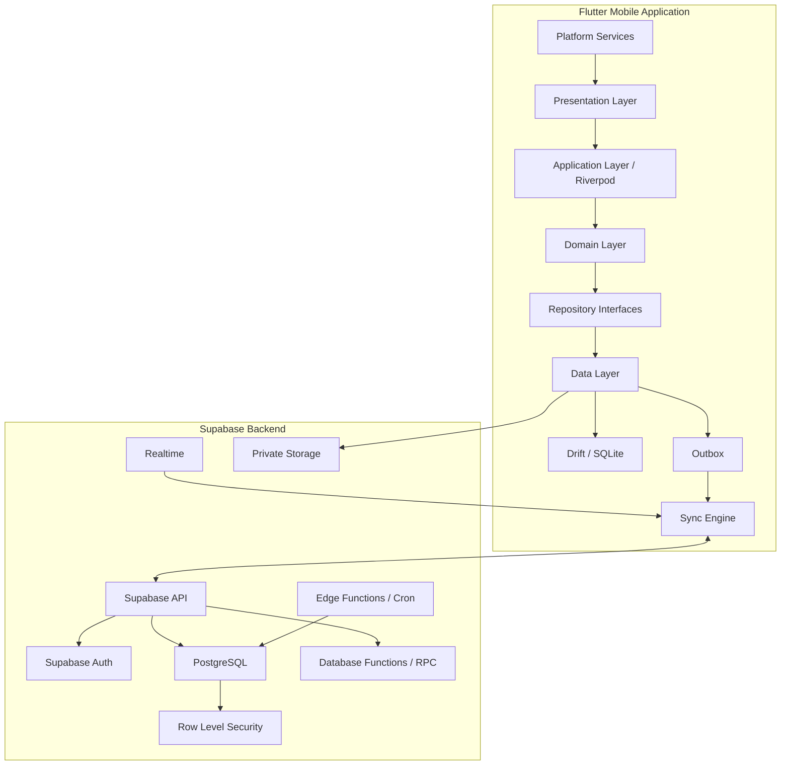
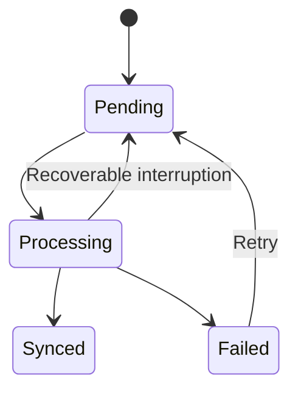
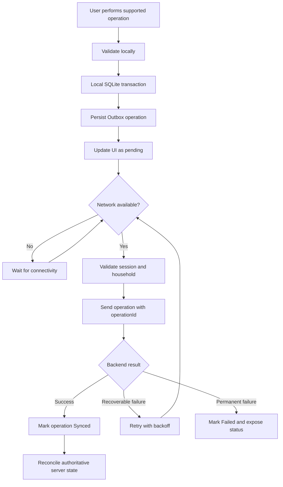
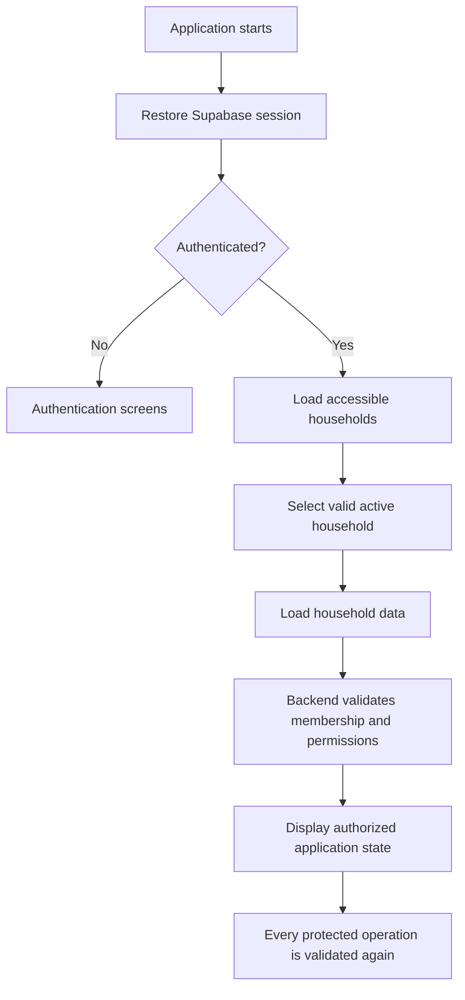

# PantryMate — System Architecture

**Document:** ARCHITECTURE.md  
**Project:** PantryMate  
**Status:** Approved Architecture Baseline  
**Platforms:** Android and iOS  
**Architecture Style:** Feature-First + Practical Clean Architecture

---

## 1. Purpose

This document defines the system architecture and the responsibilities of its main components.

It translates the approved functional and technical decisions into architectural boundaries.

It is intended to guide implementation and prevent:

- Direct database access from UI components.
- Business logic duplication.
- Unauthorized data access.
- Inconsistent inventory operations.
- Unsafe synchronization.
- Uncontrolled dependencies between features.
- Unnecessary architectural complexity.

This document does not claim that any component has already been implemented.

## 2. Architecture Overview

PantryMate follows a local-first mobile architecture connected to a Supabase backend.

The mobile application contains:

- Presentation layer.
- Application/state-management layer.
- Domain layer.
- Data layer.
- Local persistence.
- Synchronization engine.
- Platform integration services.

The backend contains:

- Supabase Authentication.
- PostgreSQL.
- Row Level Security.
- Database functions/RPC.
- Supabase Realtime.
- Supabase Storage.
- Edge Functions.
- Scheduled jobs.

### 2.1 High-Level Architecture



The diagram represents logical responsibilities. It does not prescribe an exact package or class structure.

## 3. Core Architectural Principles

### 3.1 Feature-First Organization

Code is grouped primarily by business feature.

Each feature owns its presentation, application logic, domain rules, and data access components where appropriate.

Shared infrastructure belongs in dedicated core modules.

### 3.2 Practical Clean Architecture

Separate:

- Presentation concerns.
- Application orchestration.
- Domain/business rules.
- Data access and external integrations.

Do not introduce abstractions without a clear purpose.

### 3.3 Repository Pattern

Repositories isolate features from persistence details.

A feature must not depend directly on Supabase client calls or SQLite queries from UI code.

### 3.4 Local-First

Supported operations interact with local persistence first.

Remote synchronization happens independently.

The application must expose pending and failed synchronization states.

### 3.5 Backend Authority

Supabase/PostgreSQL is authoritative for shared household data, authorization, and critical transactional operations.

Local SQLite is the local operational cache and pending-change store.

### 3.6 Explicit Boundaries

A feature must not directly manipulate another feature's internal database implementation.

Cross-feature behavior must use explicit interfaces or application-level coordination.

## 4. Flutter Project Structure

The proposed structure is:

```text
lib/
├── main.dart
├── app/
│   ├── app.dart
│   ├── bootstrap.dart
│   ├── router/
│   │   ├── app_router.dart
│   │   ├── route_guards.dart
│   │   └── deep_link_handler.dart
│   ├── theme/
│   └── localization/
│
├── core/
│   ├── config/
│   ├── constants/
│   ├── errors/
│   ├── logging/
│   ├── network/
│   ├── permissions/
│   ├── security/
│   ├── utils/
│   ├── widgets/
│   └── services/
│
├── shared/
│   ├── models/
│   ├── enums/
│   ├── validators/
│   └── components/
│
├── features/
│   ├── authentication/
│   ├── onboarding/
│   ├── households/
│   ├── invitations/
│   ├── members/
│   ├── products/
│   ├── inventory/
│   ├── storage_locations/
│   ├── barcode_scanner/
│   ├── shopping_lists/
│   ├── shopping_history/
│   ├── dashboard/
│   ├── reports/
│   ├── notifications/
│   ├── activity/
│   ├── profile/
│   ├── settings/
│   ├── favorites/
│   ├── feedback/
│   └── data_management/
│
├── infrastructure/
│   ├── database/
│   │   ├── local/
│   │   ├── remote/
│   │   └── migrations/
│   ├── synchronization/
│   │   ├── outbox/
│   │   ├── engine/
│   │   ├── conflict_resolution/
│   │   └── change_tracking/
│   ├── storage/
│   ├── notifications/
│   └── external_apis/
│
└── generated/
```

This is a target structure, not permission to create every directory before it is needed.

Feature subdirectories should follow a consistent internal structure.

Example:

```text
features/
└── inventory/
    ├── presentation/
    │   ├── pages/
    │   ├── widgets/
    │   └── providers/
    ├── application/
    │   └── use_cases/
    ├── domain/
    │   ├── entities/
    │   ├── repositories/
    │   └── rules/
    └── data/
        ├── models/
        ├── datasources/
        └── repositories/
```

Not every feature requires every directory. Keep the implementation proportional to its complexity.

## 5. Layer Responsibilities

### 5.1 Presentation Layer

Responsible for:

- Screens and widgets.
- User interaction.
- Form input.
- UI state rendering.
- Navigation requests.
- Accessibility.
- Loading, empty, error, offline, and success states.

Must not:

- Execute direct SQL.
- Perform direct Supabase database operations.
- Contain complex business rules.
- Decide authorization based only on UI visibility.

### 5.2 Application Layer

Responsible for:

- Use-case orchestration.
- Coordinating repositories.
- Managing feature-level operations.
- Invoking synchronization-aware workflows.
- Handling application actions.
- Exposing state through Riverpod.

Examples:

- CreateProduct.
- AddInventoryBatch.
- ConsumeInventory.
- PurchaseShoppingItem.
- AcceptInvitation.
- TransferOwnership.

Critical operations must use the approved transactional backend workflows.

### 5.3 Domain Layer

Responsible for:

- Business entities.
- Business rules.
- Value objects.
- Repository contracts.
- Validation rules independent of infrastructure.

Examples:

- Product.
- InventoryBatch.
- InventoryQuantity.
- ShoppingList.
- HouseholdMembership.
- Invitation.
- InventoryEvent.

The domain layer must not depend on Flutter UI or Supabase implementation details.

### 5.4 Data Layer

Responsible for:

- Repository implementations.
- Local and remote data sources.
- Data mapping.
- Serialization.
- Cache coordination.
- Persistence operations.
- Error translation.

Repositories decide how to obtain and persist data according to the operation's offline and consistency requirements.

## 6. State Management

Use Riverpod for application and UI state management.

Responsibilities include:

- Exposing repository data to the UI.
- Managing asynchronous loading states.
- Coordinating use cases.
- Managing active household context.
- Reacting to authentication changes.
- Exposing synchronization status.
- Disposing obsolete subscriptions and requests.

Avoid storing the same authoritative state independently in multiple providers.

Household-scoped providers must be invalidated or refreshed when the active household changes.

Responses from a previous household must never overwrite the current household's state.

## 7. Navigation

Use go_router.

Navigation must support:

- Authentication redirects.
- Protected routes.
- Household selection.
- Invitation deep links.
- Notification deep links.
- Unavailable or expired destinations.

Route guards are a UX and navigation mechanism.

They do not replace backend authorization or RLS.

Every protected data operation must still be validated remotely.

## 8. Local Persistence

Use Drift with SQLite.

### 8.1 Responsibilities

Local persistence supports:

- Cached household data.
- Products.
- Inventory batches.
- Shopping lists and items.
- Relevant history.
- Notification preferences cache.
- Pending Outbox operations.
- Synchronization metadata.
- Change tracking cursors.

The final schema must be derived from approved functional requirements and database design.

### 8.2 Local Database Rules

- Use versioned migrations.
- Use transactions for related local writes.
- Enforce appropriate local constraints.
- Preserve pending operations across application restarts.
- Scope household data correctly.
- Avoid exposing cached data across accounts.
- Handle local database upgrades safely.

### 8.3 Local Database Is Not a Backup

Device loss or application removal may result in loss of local-only pending changes.

Shared synchronized data remains recoverable through the backend, subject to retention and account access rules.

## 9. Repository and Data Source Strategy

A repository may coordinate local and remote data sources.

Typical responsibilities:

```text
Feature
   |
Use Case
   |
Repository Interface
   |
Repository Implementation
   |
   +---- Local Data Source
   |
   +---- Remote Data Source
```

### 9.1 Local Reads

For supported offline-first features, read from local SQLite and update the UI without waiting for a remote request.

### 9.2 Local Writes

For supported offline operations:

1. Validate the operation locally.
2. Persist the local change transactionally.
3. Create the corresponding Outbox operation.
4. Update UI state.
5. Allow the Sync Engine to process the operation.

### 9.3 Remote Reads

Remote reads must respect household context, pagination, authorization, and synchronization consistency.

Remote responses must not overwrite newer local pending changes incorrectly.

### 9.4 Critical Remote Operations

Operations involving sensitive stock integrity, ownership, invitation acceptance, or other approved atomic workflows must use secure backend transactions.

They must not be implemented as unsafe sequences of independent client writes.

## 10. Synchronization Architecture

Synchronization is an independent infrastructure subsystem.

### 10.1 Main Components

- Outbox repository.
- Sync Engine.
- Connectivity monitor.
- Operation handlers.
- Retry manager.
- Idempotency handling.
- Conflict resolver.
- Remote change tracking.
- Synchronization status provider.

### 10.2 Outbox Lifecycle



The exact status transitions must be implemented safely, including recovery from a process crash.

### 10.3 Synchronization Flow



### 10.4 Idempotency

Every operation must have a stable unique operation ID.

The backend must recognize repeated delivery of the same logical operation.

A retry must not:

- Add stock twice.
- Consume stock twice.
- Purchase an item twice.
- Create duplicate inventory events.
- Accept the same invitation twice.

### 10.5 Conflict Resolution

Ordinary records use server-authoritative version/revision handling.

Sensitive stock mutations use transactional backend logic.

Device timestamps must not be treated as sufficient authority for shared conflict resolution.

### 10.6 Incremental Change Tracking

The synchronization design must use a reliable server-side change tracking mechanism such as revisions, cursors, or an equivalent change log.

Realtime can wake the synchronization process, but clients must reconcile using authoritative change data.

Archive and deletion operations require tombstones or equivalent change records.

### 10.7 Account and Household Isolation

Pending operations must remain tied to the original user and household.

Before processing, the backend must validate current authorization.

A household switch must not mix Outbox operations or cached state from different households.

Membership revocation must stop unauthorized synchronization.

## 11. Supabase Backend Architecture

### 11.1 Supabase Auth

Responsible for:

- Account authentication.
- Provider authentication.
- Session lifecycle.
- Token refresh.
- Password recovery.

Application-level authorization remains separate from authentication.

### 11.2 PostgreSQL

Responsible for:

- Shared relational data.
- Constraints.
- Transactions.
- Referential integrity.
- Critical inventory operations.
- Historical events.
- Server-side change tracking.

### 11.3 Row Level Security

RLS policies must enforce:

- Household membership.
- Household data isolation.
- Role-based permissions.
- Ownership boundaries.
- Appropriate record visibility.

RLS policies must be tested with all relevant user roles and non-member scenarios.

### 11.4 Database Functions and RPC

Use transactional functions for sensitive workflows where required.

Examples:

- Consume inventory.
- Purchase shopping item and update inventory.
- Undo eligible inventory operation.
- Accept invitation.
- Transfer ownership.
- Remove member.

Functions must validate current authorization and state inside the transaction.

Any privileged execution configuration requires security review.

### 11.5 Supabase Realtime

Use Realtime to signal that remote data may have changed.

The client then reconciles with authoritative server state.

Realtime event delivery must not be treated as a guaranteed complete synchronization history.

### 11.6 Supabase Storage

Use private storage for product images and other approved files.

Access must be authorization-controlled.

Object paths alone must not be considered proof of ownership.

### 11.7 Edge Functions and Scheduled Jobs

Use backend functions and scheduled jobs for:

- Expiration checks.
- Notification processing.
- Scheduled maintenance.
- Safe cleanup.
- Other backend tasks requiring privileged execution.

Do not expose service-role credentials to the mobile client.

## 12. Inventory Domain Architecture

The inventory model separates:

- Product.
- Inventory Batch.
- Inventory Event.
- Storage Location.
- Unit.

### 12.1 Product

Represents the household's shared product catalog entry.

It stores product-level metadata.

### 12.2 Inventory Batch

Represents a specific quantity of a product at a particular location, with its own expiration information.

### 12.3 Inventory Event

Records stock-changing actions and relevant historical context.

Events are append-only through ordinary application operations.

### 12.4 Quantity Integrity

All stock changes must respect:

- Non-negative quantity.
- Unit precision.
- Product base unit.
- Available quantity rules.
- Transactional concurrency protection.
- Idempotency.

### 12.5 FEFO Consumption

Default consumption selects the eligible batch with the nearest expiration date.

Batches without expiration dates follow the approved oldest-created-first ordering.

Manual batch selection remains supported.

### 12.6 Low-Stock Calculation

The low-stock subsystem calculates the relevant aggregate quantity across active batches.

Expired batches remain visible but are excluded from available quantity according to the approved technical decision.

Threshold changes, archive/restore, consumption, and restocking must trigger recalculation.

## 13. Shopping Architecture

Shopping functionality is separated into:

- Shopping List.
- Shopping List Item.
- Shopping History.
- Purchase operation.

Shopping item duplicate handling follows the same-product-and-same-unit rule.

A purchase operation must coordinate shopping state and inventory state atomically.

Free-text items remain supported without requiring a catalog product.

Shopping history must preserve required purchase and removal attribution.

## 14. Authentication and Authorization Flow



Authentication proves identity.

Authorization determines what that identity may access in a specific household.

A valid session does not imply access to every household.

## 15. Notification Architecture

Notification processing is divided into:

- Event creation.
- Notification eligibility evaluation.
- User preference evaluation.
- Quiet-hours evaluation.
- Delivery scheduling.
- Provider submission.
- Delivery status tracking.
- Deduplication.
- Retry handling.
- Deep-link validation.

Backend scheduling is primary for shared scheduled events.

Local notifications provide an appropriate device-side fallback.

Push delivery must not be represented as guaranteed.

Notification payloads must avoid exposing invitation secrets or sensitive household information.

## 16. External Integrations

### 16.1 Open Food Facts

Used for optional barcode-based product lookup.

The integration must:

- Handle API errors.
- Respect rate limits.
- Cache appropriate responses.
- Preserve user edits.
- Provide manual fallback.
- Respect attribution and licensing requirements.

External API availability must not block core inventory operations.

### 16.2 Firebase Cloud Messaging and APNs

Used for push notification delivery.

Device token lifecycle, invalidation, and retry behavior must be managed.

### 16.3 Sentry or Equivalent

Used for approved crash, runtime, synchronization, and performance monitoring.

Sensitive information must be redacted.

## 17. Error Handling

Errors must be classified appropriately.

Examples include:

- Validation errors.
- Authentication errors.
- Authorization errors.
- Network errors.
- External API errors.
- Conflict errors.
- Storage errors.
- Database constraint errors.
- Synchronization failures.
- Recoverable versus permanent failures.

The presentation layer must receive understandable error states without exposing internal secrets or unnecessary technical details.

## 18. Security Boundaries

### Mobile Client

The client may contain:

- Supabase publishable/anon key.
- Public configuration.
- User-facing application logic.

It must not contain:

- Supabase service-role key.
- FCM server credentials.
- Private API secrets.
- Privileged backend credentials.

### Backend

The backend is responsible for:

- Authorization.
- RLS.
- Transactional operations.
- Secret management.
- Critical validation.
- Scheduled privileged jobs.

### Local Device

Sensitive session information must use secure platform storage.

Cached household information must be isolated by account and household context.

## 19. Testing Boundaries

Architecture must support isolated tests for:

- Domain rules.
- Use cases.
- Repository implementations.
- Local persistence.
- Synchronization.
- Backend operations.
- RLS authorization.
- Navigation.
- Notification scheduling.
- External API failure handling.

Critical inventory and synchronization workflows require integration and concurrency testing.

## 20. Architecture Governance

1. The approved architecture must be followed.
2. New abstractions require a clear justification.
3. Features must not bypass repository boundaries.
4. UI code must not become a data-access layer.
5. Critical business invariants must be enforced at the backend.
6. No secret may be embedded in the mobile application.
7. Any architecture change must identify affected TD decisions and features.
8. Architecture changes require explicit approval.
9. Existing project structure must be inspected before creating or moving files.
10. Do not create speculative modules or unnecessary directories before implementation requires them.

## 21. Open Implementation-Time Verification

The following details must be verified before their implementation or release:

- Exact Flutter and Dart versions.
- Compatible package versions.
- Supabase plan limits.
- PostgreSQL schema and index design.
- Exact RLS policy definitions.
- Secure RPC implementation details.
- Incremental synchronization schema.
- Supabase backup and restore capabilities.
- Push provider configuration.
- Email invitation delivery provider.
- Storage limits and compression parameters.
- Open Food Facts current API and licensing requirements.
- Minimum Android and iOS versions.
- GitHub Actions runner capabilities.
- Numerical performance targets.
- Privacy, legal, and retention obligations.

These are verification tasks, not permission to change approved functional behavior.

**End of Architecture Document**
