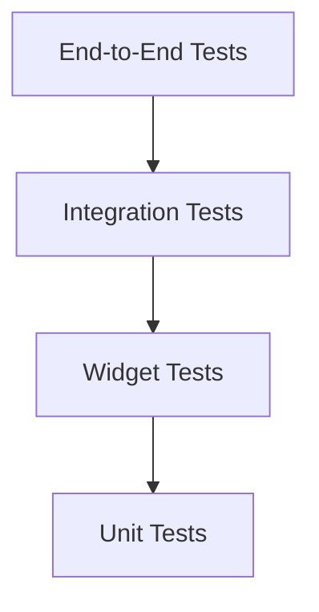

# PantryMate — Testing Strategy

**Document:** TEST.md  
**Project:** PantryMate  
**Status:** Approved Testing Baseline  
**Applies to:** Flutter, Dart, Supabase, PostgreSQL, synchronization and integrations.

---

## 1. Purpose

This document defines the testing strategy, quality gates, and completion criteria for PantryMate.

Its objectives are to:

- Prevent regressions.
- Protect inventory integrity.
- Verify authorization and household isolation.
- Validate offline-first behavior.
- Detect synchronization failures.
- Ensure reliable database transactions.
- Validate Android and iOS behavior.
- Require evidence before declaring tasks complete.

Passing tests does not automatically prove that the entire application is production-ready.

## 2. Testing Principles

1. Tests must validate actual requirements, not implementation assumptions.
2. Critical business rules must have automated tests.
3. Security must be tested independently of UI behavior.
4. Offline and synchronization behavior must be tested explicitly.
5. Critical inventory operations must be tested under concurrency.
6. Tests must be deterministic whenever possible.
7. External services must be mocked or isolated in unit tests.
8. Integration tests must use controlled test environments.
9. Every bug fix should include a regression test when practical.
10. No task is complete without the required verification evidence.

## 3. Testing Pyramid



### 3.1 Unit Tests

Test isolated business rules and application logic.

Examples:

- Quantity validation.
- Unit validation.
- Expiration calculations.
- Low-stock calculations.
- Duplicate shopping item detection.
- FEFO ordering.
- Permission decision logic.
- Retry policy.
- Conflict resolution.
- Notification eligibility.

### 3.2 Widget Tests

Test UI components and interaction behavior.

Examples:

- Forms and validation messages.
- Loading states.
- Empty states.
- Error states.
- Offline indicators.
- Household selection.
- Shopping list interactions.
- Inventory quantity updates.
- Dialogs and confirmations.
- Accessibility-related widget behavior.

### 3.3 Integration Tests

Test interactions between multiple components.

Examples:

- Repository and SQLite.
- Repository and Supabase.
- Local write and Outbox creation.
- Synchronization and remote reconciliation.
- Authentication and session restoration.
- Notification scheduling.
- Database RPC operations.
- Image upload and cleanup.

### 3.4 End-to-End Tests

Test complete user journeys.

Examples:

- Register and create a household.
- Invite and accept a member.
- Create a product and inventory batch.
- Consume stock.
- Create and purchase a shopping item.
- Switch between households.
- Use the application offline and synchronize later.
- Export household data.
- Delete or recover a household according to approved rules.

## 4. Test Environment Separation

Maintain separate environments for:

### Local Development

Used for everyday development and isolated tests.

### Test Environment

Used for integration tests, migrations, RLS validation, and automated workflows.

### Production

Real user data only.

Tests must never execute destructive operations against production data.

Test credentials and secrets must be managed independently.

## 5. Test Tools

The exact compatible versions must be verified during project setup.

| Area | Tool |
|---|---|
| Unit tests | `flutter_test` |
| Widget tests | `flutter_test` |
| Mocking | `mocktail` or approved equivalent |
| Local database | Drift test utilities |
| Backend integration | Supabase test environment |
| Database tests | PostgreSQL testing scripts or approved framework |
| Mobile E2E | `integration_test` |
| Static analysis | `flutter analyze` |
| Formatting | `dart format` |
| CI | GitHub Actions |

Do not add testing dependencies without checking compatibility and project requirements.

## 6. Unit Testing Requirements

### 6.1 Inventory

Test:

- Quantity cannot become negative.
- Zero quantity behavior.
- Valid quantity precision.
- Base unit consistency.
- FEFO ordering.
- Manual batch selection.
- Expired batch exclusion from available quantity.
- Aggregate available quantity.
- Low-stock threshold.
- Threshold changes.
- Batch archive and restore behavior.
- Expiration date changes.
- Undo eligibility and expiration.

### 6.2 Shopping

Test:

- Duplicate detection.
- Same product and same unit merging.
- Different units remaining separate.
- Free-text items.
- Multiple shopping lists.
- Purchase state transitions.
- Shopping history behavior.
- Double purchase prevention.

### 6.3 Dates and Timezones

Test:

- Date-only expiration handling.
- Household timezone behavior.
- Daylight-saving transitions where applicable.
- Device timezone differences.
- Notification scheduling.
- Quiet hours.
- Expiration reminder calculations.

### 6.4 Permissions

Test:

- Owner permissions.
- Manager permissions.
- Member permissions.
- Removed member behavior.
- Household context changes.
- Unauthorized operations.
- Ownership transfer restrictions.

### 6.5 Synchronization

Test:

- Stable operation IDs.
- Idempotent retries.
- Exponential backoff.
- Recoverable failures.
- Permanent failures.
- Duplicate operation delivery.
- Outbox recovery after application restart.
- Household queue isolation.
- Account switching.
- Stale remote responses.
- Cursor progression.
- Tombstone processing.

## 7. Widget Testing Requirements

Every important screen must cover relevant UI states.

### Required UI States

- Initial loading.
- Successful loaded state.
- Empty state.
- Validation error.
- Network error.
- Offline state.
- Pending synchronization.
- Failed synchronization.
- Permission denied.
- Session expired.
- Destructive confirmation.

### Interaction Testing

Verify:

- Buttons execute the correct action.
- Forms reject invalid input.
- Navigation reaches the correct destination.
- Dialogs behave correctly.
- Filters and search work.
- Lists update after operations.
- Duplicate actions are prevented where required.
- Loading indicators prevent inappropriate repeated actions.

### Accessibility

Test:

- Semantic labels.
- Screen-reader descriptions.
- Text scaling.
- Contrast requirements.
- Focus order.
- Touch target usability.
- RTL layout.
- Localization overflow.

## 8. Database and Backend Testing

### 8.1 Database Constraints

Test:

- Foreign keys.
- Unique constraints.
- Check constraints.
- Required fields.
- Valid quantity precision.
- Valid status transitions.
- Household ownership relationships.
- Referential integrity.

### 8.2 RLS Tests

Test each relevant operation using:

- Household owner.
- Manager.
- Member.
- Authenticated non-member.
- Unauthenticated user.
- Removed member.
- User belonging to another household.

Verify that unauthorized users cannot:

- Read household data.
- Insert unauthorized records.
- Update protected records.
- Delete protected records.
- Access private storage objects.
- Execute privileged operations.

Do not rely on application-level route guards as proof of authorization.

### 8.3 Transaction Tests

Critical operations must be tested for atomicity.

Examples:

- Consume inventory.
- Purchase shopping item.
- Accept invitation.
- Transfer ownership.
- Remove household member.
- Undo eligible operation.

For each transaction, verify that partial failure does not leave inconsistent state.

### 8.4 Concurrency Tests

Simulate simultaneous operations.

Examples:

- Two devices consuming the same batch.
- Two users purchasing the same item.
- Concurrent invitation acceptance.
- Concurrent product creation with the same unique identifier.
- Concurrent stock adjustments.
- Concurrent ownership or membership changes.

Verify that database constraints and transactions preserve the approved invariants.

## 9. Offline and Synchronization Testing

Offline behavior is a critical quality area.

### 9.1 Offline Scenarios

Test:

- Application startup without connectivity.
- Reading cached data.
- Supported local writes.
- Outbox persistence.
- Application restart with pending operations.
- Connectivity restoration.
- Delayed synchronization.
- Failed synchronization.
- Session expiration while offline.
- Logout with pending operations.
- Account switching.
- Household switching.

### 9.2 Synchronization Scenarios

Test:

- Duplicate operation delivery.
- Network interruption during submission.
- Network interruption after server success but before local acknowledgment.
- Retry after timeout.
- Server-side rejection.
- Membership revocation.
- Stale local records.
- Missing change events.
- Cursor recovery.
- Tombstones.
- Conflict visibility.
- Large pending queues.

### 9.3 Required Invariants

- No duplicate stock mutation.
- No negative stock.
- No cross-household synchronization.
- No unauthorized operation replay.
- No silent permanent loss of pending operations.
- No false success state for a failed operation.
- No incorrect overwrite of newer authoritative data.

## 10. Inventory Critical Scenarios

The following scenarios require automated coverage.

| Scenario | Expected Result |
|---|---|
| Consume more than available quantity | Operation rejected |
| Consume an eligible batch | Correct quantity deducted |
| Consume with FEFO | Correct eligible batch selected |
| Two concurrent consumption requests | No negative stock |
| Repeat the same operation ID | No duplicate mutation |
| Purchase the same item twice | No duplicate inventory addition |
| Undo an eligible action | Correct reversal |
| Undo after expiry window | Rejected |
| Archive a batch | Availability recalculated |
| Restore a batch | Availability recalculated |
| Change low-stock threshold | Status recalculated |
| Expired batch | Excluded from available quantity |

## 11. Authentication and Household Testing

Test:

- Registration.
- Login.
- Logout.
- Session restoration.
- Token refresh.
- Password recovery.
- Account linking.
- Invitation creation.
- Invitation expiration.
- Invitation revocation.
- Invitation acceptance.
- Duplicate invitation handling.
- Member removal.
- Role changes.
- Ownership transfer.
- Household deletion.
- Household recovery.
- Account deletion.
- Account data export.

Special attention is required for:

- Last-owner protection.
- Household recovery boundaries.
- Deleted account attribution.
- Pending invitation cleanup.
- Private cached data after logout.
- Pending synchronization during account deletion.

## 12. Notifications Testing

Test:

- Expiration reminders.
- Low-stock notifications.
- Invitation notifications.
- Household activity notifications.
- User preference changes.
- Quiet hours.
- Snoozing.
- Duplicate event prevention.
- Notification rescheduling.
- OS notification permission denied.
- Invalid device tokens.
- Removed household member.
- Deep-link authorization.
- Push delivery retries.

Do not assert exactly-once push delivery.

Validate application-level deduplication and realistic delivery guarantees.

## 13. Storage and External API Testing

### 13.1 Images

Test:

- Upload success.
- Upload failure.
- Offline upload queue.
- Unauthorized access.
- Image replacement.
- Image deletion.
- Household deletion cleanup.
- Account deletion cleanup.
- Invalid file type.
- File size limits.
- Interrupted upload.

### 13.2 Barcode and Open Food Facts

Test:

- Valid barcode.
- Unknown barcode.
- Invalid response.
- API timeout.
- Rate limiting.
- Missing product fields.
- Manual fallback.
- User modification of retrieved data.
- Cache behavior.

External API failure must not block manual product creation.

## 14. Data Management Testing

Test:

- CSV export.
- PDF export.
- Empty exports.
- Large exports.
- Special characters.
- RTL text.
- Permission restrictions.
- Export during concurrent changes.
- Import validation where supported.
- Duplicate records.
- Invalid references.
- Partial failure handling.
- Deletion and recovery interactions.

## 15. Migration Testing

Every database migration must be tested.

Required checks:

1. Migration from an empty database.
2. Migration from the previous supported schema.
3. Existing data preservation.
4. Constraint validity.
5. Index creation.
6. Roll-forward behavior.
7. Migration failure handling.
8. Local database upgrade.
9. Backend schema compatibility.

Never assume a migration is safe merely because it runs successfully on an empty database.

## 16. Regression Testing

Every bug fix should include:

- A reproducible scenario.
- A test demonstrating the previous failure.
- A test confirming the corrected behavior.
- Relevant existing regression tests.

Before merging a task, run tests covering affected features and their dependencies.

## 17. Performance Testing

Performance targets must be established and measured before release.

Evaluate:

- Application startup.
- Dashboard loading.
- Large inventory lists.
- Search responsiveness.
- Pagination.
- Local database queries.
- Synchronization queue throughput.
- Image loading.
- Memory usage.
- Battery impact.
- Background work.

Avoid inventing performance benchmarks before measuring the target devices and data volumes.

## 18. CI Quality Gates

Every implementation task must pass the applicable checks.

Minimum automated checks:

```bash
dart format --output=none --set-exit-if-changed .
flutter analyze
flutter test
```

Additional checks when relevant:

- Database migration validation.
- RLS tests.
- Backend integration tests.
- Synchronization tests.
- Mobile integration tests.
- Build verification for Android.
- Build verification for iOS.

CI must not expose production secrets.

A passing CI run does not replace required manual security or architecture review.

## 19. Test Data Management

Test data must be:

- Deterministic.
- Isolated from production.
- Reproducible.
- Explicitly initialized.
- Cleaned up safely.

Avoid tests depending on real external API availability.

Use controlled fixtures for:

- Households.
- Users and roles.
- Products.
- Inventory batches.
- Shopping lists.
- Invitations.
- Notifications.
- Synchronization operations.

## 20. Bug Severity

### Critical

Examples:

- Cross-household data exposure.
- Unauthorized access.
- Negative inventory.
- Duplicate critical stock mutation.
- Data corruption.
- Secret exposure.

Must block release.

### High

Examples:

- Core feature unavailable.
- Synchronization causing incorrect shared data.
- Invitation or ownership workflow failure.
- Significant data loss.

Must block affected release scope until resolved.

### Medium

Examples:

- Important UI behavior broken.
- Incorrect non-critical report.
- Recoverable notification issue.

Requires documented resolution or an explicitly approved release decision.

### Low

Examples:

- Minor visual inconsistency.
- Non-critical text or spacing issue.

May be deferred with documentation.

## 21. Definition of Done

A task is complete only when:

- Acceptance criteria are satisfied.
- Implementation respects SPEC.md.
- Relevant FD, TD, and Gap decisions are respected.
- Architecture boundaries are respected.
- Required tests are added.
- Relevant existing tests pass.
- Static analysis passes.
- Formatting passes.
- Security implications are reviewed.
- Offline behavior is verified when applicable.
- Error handling is implemented.
- No unrelated files are modified.
- Documentation is updated when necessary.
- Verification results are reported accurately.

A task must not be marked complete based on code generation alone.

## 22. Verification Report

Every completed task must report:

```text
Task:
Branch:
Files changed:
Requirements covered:
Decisions affected:

Tests added:
Tests executed:
Test results:

Static analysis:
Formatting:
Build verification:

Security review:
Offline/sync review:

Known limitations:
Remaining risks:

Final status:
```

Do not claim a check passed if it was not executed.

If a command cannot run, report the reason and the remaining verification required.

## 23. Release Readiness

Before a production release, verify:

- All critical requirements are implemented.
- Critical and high-severity bugs are resolved.
- Authentication and authorization tests pass.
- RLS and database security tests pass.
- Inventory concurrency tests pass.
- Offline and synchronization tests pass.
- Data migration and recovery procedures are reviewed.
- Notification behavior is validated.
- Android and iOS builds are verified.
- Privacy and data deletion requirements are reviewed.
- Monitoring and error reporting are configured.
- Backup and recovery capabilities are verified.
- Release configuration contains no exposed secrets.

**End of Testing Strategy**
